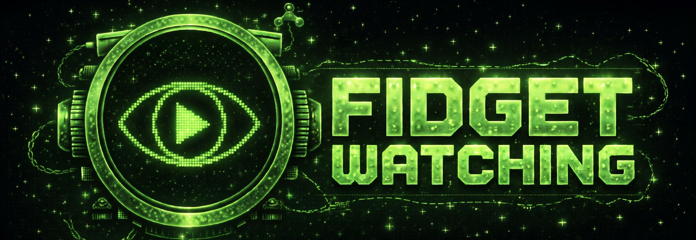

# fidget-watching

A fork of [devinilabs/claude-watch](https://github.com/devinilabs/claude-watch). devinilabs built the pipeline. I added the key-free whisper.cpp route, channel and playlist mode, and the fixes in the [changelog](CHANGELOG.md).

**Turn any tutorial or lecture video into structured study notes.** Paste a URL, walk away, come back to a markdown file with embedded screenshots, timestamped transcript, and Claude's synthesis — saved to a persistent library.

```
/watch https://youtu.be/<lecture> backprop intuition
```

More: [ESSENCE.md](ESSENCE.md) · [EVOLUTION.md](EVOLUTION.md)

## Why I forked it

I installed claude-watch and it asked for an API key. My exact reaction: "i thought i have audio downloaders setup so i dont need these stupid keys. dont i already have ffmpeg and whisper?" I did, so now it uses them. Then: "can i do it to a whole youtube cahnnel?" Now it can do that too. The idea is devinilabs', and it's a great one: scene-aware frames, a library you can come back to, and a notes file instead of answers lost in chat. Everything I changed is in the [changelog](CHANGELOG.md).

## Install

| Surface | Command |
|---|---|
| **Claude Code** | `/plugin marketplace add fidgetcoding/fidget-watching` then `/plugin install watch@watch` |
| **claude.ai** (web) | Download `watch.skill` from the latest release → Settings → Capabilities → Skills → `+` |
| **Codex** | `git clone https://github.com/fidgetcoding/fidget-watching ~/.codex/skills/watch` |

## What it does

1. Downloads via `yt-dlp` (or accepts a local file).
2. Detects scene changes with `ffmpeg`. Inserts coverage-floor frames every 45s across long static gaps so a lecture with one slide for 5 minutes still gets ~7 frames, not 1.
3. Pulls a timestamped transcript: captions first (free), then local whisper.cpp if you have it, then the Whisper API (Groq preferred, OpenAI alt).
4. Hands frames + transcript to Claude. Claude `Read`s every frame as an image and writes `notes.md` to a strict template:
   - `## TLDR` — 3-4 sentence synthesis
   - `## Key Concepts` — bulleted with timestamps
   - `## Notes` — one section per scene with embedded screenshot, on-screen text, what was said, Claude's synthesis
   - `## Code & Commands` — every code-on-screen frame transcribed into a runnable fenced block
   - `## Diagrams Referenced`, `## Open Questions`
5. Over 30 minutes, it does that part by part and merges the result, so the end of a long video gets the same attention as the start.
6. Saves everything to `~/watch/library/<slug>/` — re-running the same URL is a cache hit.

## Usage

```
/watch <url-or-path> [topic]
/watch ~/Lectures/cs231n.mp4 backpropagation derivation
/watch https://youtu.be/<long>                     # over 30 minutes gets written in sections
/watch https://youtu.be/<long> --start 5:00 --end 25:00
/watch <url> --resolution 1024            # for slides with tiny code text
```

Flags: `--start/--end`, `--max-frames`, `--resolution`, `--scene-threshold`, `--max-gap`, `--no-sections`, `--section-minutes`, `--whisper local|groq|openai`, `--no-whisper`, `--cookies-from-browser`, `--out-dir`, `--limit N` (channel mode), `--single` (force per-video).

### Natural-language activation

You don't have to remember the slash command. Drop a video URL into chat with any of these (and obvious variants) and the skill auto-triggers:

- "watch this video / lecture / tutorial / talk" + URL
- "study this video / take notes on this / give me notes on this"
- "transcribe this video / reel / tiktok"
- "summarize this video" / "summarize this with frames"
- "break down this video / reel / lecture"
- "analyze this video / channel / youtube"
- "frame by frame" / "frame-aware notes" / "with screenshots"
- "scrape this channel / creator / youtube"
- "sweep this channel / playlist"
- "what hooks does this creator use" / "hook analysis" / "script structure" / "cloneable moves"
- "study this creator" / "research this creator" / "channel research"
- Or just paste a URL and say "watch this" / "scrape this" / "take notes."

The SKILL.md description ships an explicit trigger list so Claude Code's auto-router picks the right skill instead of guessing.

## Bring your own keys

You don't need any. Captions cover most public videos for free, and with whisper.cpp installed, videos without captions are free too.

| Need | Cost |
|---|---|
| Download + native captions | free (`yt-dlp` + `ffmpeg`) |
| Whisper fallback, no key (used first) | free: `brew install whisper-cpp`, plus a model at `~/.config/watch/models/ggml-base.en.bin` |
| Whisper fallback, API (preferred) | Groq `whisper-large-v3`: cheap, fast |
| Whisper fallback, API (alt) | OpenAI `whisper-1` |
| Disable Whisper | `--no-whisper` (frames-only when no captions) |

Keys go in `~/.config/watch/.env` (mode 0600).

## Re-running the same video

The library is keyed on `slug = YYYY-MM-DD-<title>-<short-hash>` where the short hash is `sha1(source + focus_range)[:4]`. Re-running the same URL with the same focus range hits the cache — no re-download, no re-transcribe, only frames + notes regenerate. Different focus range = different slug = a separate notes file.

To force a fresh run, delete the `meta.json` in the library dir.

## Limits

- **Long videos get written in sections.** Over 30 minutes, `/watch` splits the video into parts of about 20 minutes, cutting at pauses and scene changes. Claude writes each part from only its own frames and transcript, then a check and a merge build one `notes.md`. No `--start`/`--end` needed, though they still work. The check catches timestamps outside their part, links to frames that don't exist, long stretches with no notes, and quotes that aren't in the transcript. It can't catch everything: Claude still writes the notes, and it can still misread a slide.
- **Frames cost tokens, and the budget scales instead of hiding that.** The default used to be a flat 80. Now it's up to 6 frames a minute for the first 15 minutes, 2.5 a minute to the hour and 1.5 a minute after that, and a slow video only uses what its scene changes and the 45-second coverage floor need. Before it reads anything, `/watch` prints the frame count and estimated tokens. `--max-frames` overrides the budget. Every extra frame costs the same again, about 210 input tokens at 512 px.
- **No transcript length limit, so long videos don't need captions.** The Whisper APIs cap uploads at 25 MB (about 50 minutes here), so longer audio goes up in overlapping chunks and comes back as one timeline. Local whisper.cpp has no upload to cap.
- **Private videos need your own login, and you have to ask for it.** Public URLs and local files work out of the box. For anything your account can already watch, add `--cookies-from-browser firefox`. See below.
- **I don't get around paywalls or DRM.** A login gets you what your account already has, and nothing more. DRM-protected streaming stops with a plain message, and so does anything your account hasn't paid for.

## Private videos and login walls

If you can watch a video in your browser, `/watch` can use that login for one run. That covers private posts, Instagram, members-only videos you're a member of, and internal video sites. It's opt-in, and it's off unless you add the flag:

```
/watch <url> --cookies-from-browser firefox
```

Swap `firefox` for `chrome`, `safari`, `edge`, `brave`, `chromium`, `opera`, `vivaldi` or `whale`. To pick a profile, use `firefox:<profile>`. When a site blocks yt-dlp, `/watch` stops and prints these steps, and Claude asks you before using your login.

What happens to your cookies:

- yt-dlp reads them from your browser and sends them only to the site they belong to.
- `/watch` passes along the browser's name and nothing else. It never stores, prints or uploads a cookie, and there's a test that checks a run leaves no trace of one in its output or its library folder.
- The video itself does get saved to your library, and its audio goes to Groq or OpenAI if you use those routes for a transcript. Think about that for anything confidential, and use local whisper.cpp.

What it won't do:

- **Get around a paywall.** If your account hasn't paid for it, it stops and says so.
- **Get around DRM.** Netflix-style protected streams stop with a plain message, login or not. I don't try to break that, and I won't add it.

Good to know:

- On macOS, Chrome asks for Keychain access the first time, and Safari needs Full Disk Access for your terminal. Firefox needs neither.
- Sites can rate-limit or flag accounts that download a lot, so go easy on an account you care about.
- To use a login on every yt-dlp run, put `--cookies-from-browser firefox` in `~/.config/yt-dlp/config` (`%APPDATA%\yt-dlp\config` on Windows). That's outside `/watch`, so it's your call. To undo it, delete the line.

## Develop

```bash
git clone https://github.com/fidgetcoding/fidget-watching
cd fidget-watching
python3 -m pytest                         # full suite
bash scripts/build-skill.sh               # → dist/watch.skill (claude.ai bundle)
```

Releasing: tag `vX.Y.Z`, push the tag — CI builds and attaches `watch.skill`.

## License

MIT. The `LICENSE` file is devinilabs' notice, unchanged, as MIT requires. Built on `yt-dlp`, `ffmpeg`, and Claude's multimodal `Read` tool. Whisper transcription via [Groq](https://groq.com) or [OpenAI](https://openai.com).
